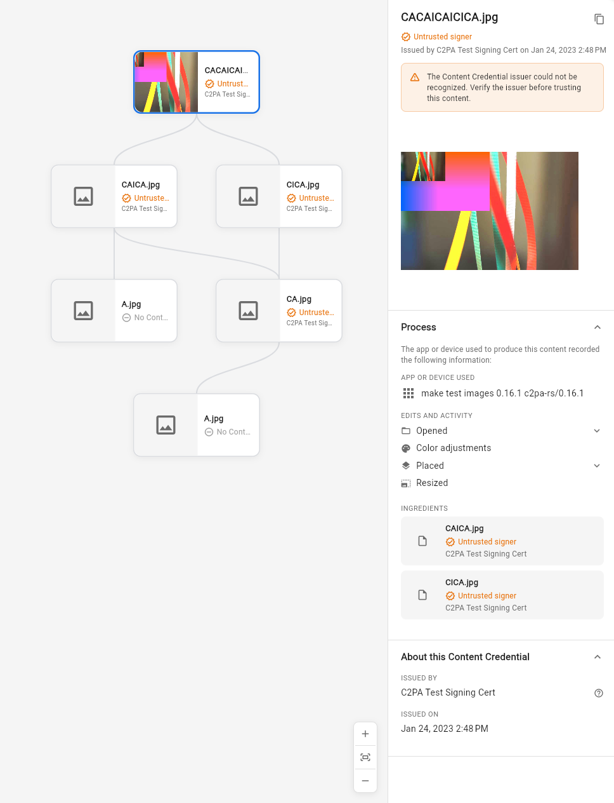

# c2pa_view

A Flutter plugin for reading and displaying [C2PA](https://c2pa.org/) (Coalition for Content Provenance and Authenticity) content credentials. It extracts embedded C2PA manifests from media files using the official `c2pa-rs` Rust library and renders provenance data as interactive Flutter widgets.

- 🗃️ Read C2PA manifests from files or raw bytes.
- 🌳 Display an interactive provenance tree with a detail panel
- 📜 Show manifest details as a popup overlay from any button
- 🔍 Access structured provenance data: actions, ingredients, signatures, EXIF, AI generation info, and more
- ✅ Full validation with trust-list checking



## Setup

Version 1.0.0 requires **Flutter 3.44 or newer**, a Rust toolchain, and the
platform build tools for each native target. Dart build hooks compile and
bundle the Rust library through FRB 2.13 Native Assets. The pinned Rust
version and targets are declared in `rust/rust-toolchain.toml`.

Upgrading from 0.x: update Flutter, run `flutter pub get`, and rebuild the
host app. Remove any manual Cargokit or c2pa_view podspec integration; the
package no longer registers a native Flutter plugin. `RustLib.init()` and
the viewer API are unchanged. Web continues to load the separately built
`web/pkg` WASM package; Native Assets does not replace it.

The build hook tracks Cargo's source inputs and crate configuration, including
paths containing spaces. It repairs the upstream dep-info path splitting before
publishing the hook output, so source changes rebuild the native reader during
ordinary incremental app builds. Missing or unreadable dep-info fails the build
instead of leaving an untracked library in the cache.

The owning app/package may optionally configure Cargo through standard hook
user-defines in its `pubspec.yaml`:

```yaml
hooks:
  user_defines:
    c2pa_view:
      cargo_home: .cache/cargo
      cargo_offline: true
```

`cargo_home` is a nonempty path relative to that pubspec and must resolve to a
valid file URI. `cargo_offline` accepts only a boolean; explicit `false` forwards
`CARGO_NET_OFFLINE=false`. Omitted settings preserve the existing environment.
These settings are passed through the builder's public Cargo environment API,
without changing features, release profile, jobs or its normal per-output target.
Hook input caching already tracks the configuration; source/dependency watches
are unchanged. Offline mode requires the selected toolchain/targets and resolved
dependencies to exist: it is not a cache/download fallback or an override of the
builder's earlier `rustup show active-toolchain` prerequisite check.

### Version compatibility note

This package intentionally pins `flutter_rust_bridge` to a specific tested
version (`2.13.0`) instead of a broad range.

If you need a different FRB version, update it together with regenerated
bindings and verify all target platforms before publishing.

### Initialization

Before any C2PA operations, initialize the Rust library once at app startup:

```dart
import 'package:c2pa_view/c2pa_view.dart';

Future<void> main() async {
  WidgetsFlutterBinding.ensureInitialized();
  await RustLib.init();
  runApp(const MyApp());
}
```

### Loading a ManifestStore

A `ManifestStore` is the root object containing all C2PA manifests found in a file. Create one from any source:

```dart
// From a local file path
final store = ManifestStore.fromLocalPath('/path/to/image.jpg');

// From raw bytes and MIME type
final store = ManifestStore.fromBytes(imageBytes, 'image/jpeg');

// From a detached sidecar (.c2pa) plus the bound asset bytes
final store = await ManifestStore.fromDetached(
  manifestBytes: sidecarBytes,
  assetBytes: imageBytes,
  assetFormat: 'image/jpeg',
);

// From a URL (async)
final store = await ManifestStore.fromUrl('https://example.com/image.jpg');
```

All methods return `null` if no C2PA manifest is found. For detached reads,
invalid manifest bytes throw; hash/signature problems appear in
`validationStatus` / `validation_results` like embedded manifests.

### Trust inputs

Pass Manifest CA PEMs in `trustAnchorsPem` and separately authorized TSA CA PEMs
in `timestampTrustAnchorsPem`. The latter is optional on the existing reader
methods; a Manifest anchor does not grant TSA authority. `allowedListPem` remains
an exact Manifest signing-leaf allow-list. Current Reader diagnostics remain
visible, including timestamp trust failures.

`TrustListService` fetches the published Manifest and TSA lists separately. Pass
both corresponding getters to readers. Its purpose-specific disk cache refetches
legacy combined caches because their certificate purposes cannot be recovered.

### API summary

| Entry point | Input | Validation |
|-------------|-------|------------|
| `ManifestStore.fromLocalPath` | File path | Embedded manifest; optional trust anchors |
| `ManifestStore.fromBytes` | Asset bytes + MIME | Embedded manifest; optional trust anchors |
| `ManifestStore.fromUrl` | HTTP URL | Embedded manifest; optional trust anchors |
| `ManifestStore.fromDetached` | Sidecar bytes + asset bytes + MIME | Full hash binding and signatures; optional trust anchors |
| `getManifestStoreJsonFromBytes` | Manifest-store bytes only | **Unverified** (no asset binding) |
| `getDetachedManifestJsonFromBytes` | Sidecar + asset bytes | Validated detached read (JSON) |

Web builds load the regenerated `web/pkg/` artifacts (`scripts/sync_web_pkg.sh`
after Rust changes). Detached validation uses the same FRB/WASM exports as
native.

**VM integration:** `flutter test test/detached_manifest_test.dart` (requires the
monorepo signing corpus; uses `dart:io` — not a Chrome target).

**Web smoke (manual, testfiles_app):**

1. From `frontend/c2pa_view`, run `scripts/sync_web_pkg.sh`.
2. `cd testfiles_app && flutter run -d chrome`.
3. Confirm the home screen loads without a Rust init timeout banner.
4. Tap **Validate detached sidecar** on the **Detached sidecar check** card.
5. Expect `validation_state: Valid` and `(assertion.dataHash.match present)`.
   Without trust-list initialization, `signingCredential.untrusted` in the JSON
   is normal — the smoke check only requires hash binding success.

## Embedded preview reader contract

Every native and WASM read entry point enriches only manifest and ingredient
`thumbnail` objects using SDK resource stores belonging to the containing claim.
SDK `resource_len` preflights borrowed assertion/databox lengths before any lazy
copy; unknown or flattened-manifest-only references fail closed. A bounded output
writer also protects the subsequent copy.
The object retains `format`/`identifier` and adds `resolution`,
`containing_manifest`, and a byte-array `data` only when resolved. Outcomes are
`resolved`, `missing`, `malformed`, `unsupported`, `oversize`, or `limit`;
an absent thumbnail remains absent (including deliberate producer omission).
HTTP/file/data resource identifiers are never fetched. JPEG and PNG previews,
including JPEG video posters, use the same portable contract.

Hydration visits at most 256 manifests and 1024 ingredient/thumbnail references.
Identifiers are limited to 4096 bytes, copied containing-claim labels to 256 bytes,
and MIME strings to 128 bytes. Each image is limited to 1 MiB encoded; all new
preview bytes and annotations together use at most 8 MiB serialized JSON,
including escaped context strings, failure outcomes, keys and repeated copies.
Each image is limited to 4096 pixels on either edge and 4 MiB decoded RGBA;
all emitted references together may require at most 16 MiB decoded RGBA.
Standard JPEG/PNG decoders validate pixels before emission, preserve original
encoded bytes and reject animated PNG. Codec max_alloc assists these checks;
it is not a hard heap ceiling. Repeated references
share bounded lookup outcomes but each returned byte copy counts toward the
aggregate limits. Work is iterative, visits each manifest once and does not follow
ingredient cycles. When traversal or annotation stops, the store emits
`preview_resources_truncated: true`; unvisited references retain their original
metadata and the Dart entities expose `limit`, without copying more labels/data. These bounds cover additional preview hydration, not SDK
parsing of the caller-supplied original store. Unsupported, malformed and oversized images are omitted before Flutter decode;
resolution alone proves no validity,
issuer trust or access authorization.

Graph previews prefer a node's own claim bytes, then an ingredient preview from
its consuming claim. The latter retains that containing claim's label and
validation result separately from the ancestor's signature/validation.
Per-claim `validation_status` comes from the current SDK validation log before
delta de-duplication; historical ingredient reports never override current trust.
A present empty list is a current clean result; an absent sideband is not
computed, represented by null PreviewSource.validationResult. Node summaries,
details, and latest-Seal presentation show a neutral **Not verified** state when
current diagnostics are absent. That state still has a credential and is distinct
from **No CR** for an unresolved leaf without one. Computed clean `[]` remains
valid; nonempty invalid/untrusted evidence retains precedence. The shared
`mapValidation` bare-list API continues to treat explicitly supplied lists as
computed for compatibility; manifest-aware callers pass `validationStatusComputed`.
The compact indicator uses the same neutral theme color and an unknown icon. A computed list
must be complete and well-formed: malformed/partial diagnostics never become a
clean result after filtering. Store attribution retains raw malformed rows so the
containing claim stays unverified (unattributable rows fall back to the active
claim), while valid failure/untrusted evidence still takes precedence. Null
optional URL/explanation fields and extensible status codes/extra fields retain
their existing semantics. Attribution and loading consume the same normalized manifest
collection; non-map target values are skipped once and existing strict parse
failures still reject the store. Missing or unloaded targets retain negative and
incomplete evidence through active fallback. Unmatched claim-specific successes
remain global evidence and cannot establish active validity; genuine active clean
results, matched-claim successes and existing unscoped active successes remain
supported. Recorded non-trust
input failures (for example dataHash mismatch) remain separate incoming evidence,
with their containing claim and its current validation. They still make the
corresponding input presentation invalid, even when its current signature is
trusted; neither preview resolution nor a clean latest Seal erases that evidence. Unresolved
leaves retain no-credential labels. Real components and two-hop ancestry remain
visible. Authorized host thumbnails still take precedence and mediaImage remains
a root-only fallback; embedded lookup never requests an original or remote URL.

Resource regression: `flutter test --no-pub test/embedded_preview_test.dart`.
The synthetic pixel fixture must decode/render and preserve source/trust context,
not merely contain a resource key. Native readback lives in the Rust API tests.
Native/WASM signed readback: `flutter test --no-pub --concurrency=1
test/embedded_resource_readback_test.dart`. This uses the same synthetic signed
2x2 PNG on both targets, checking claim bytes, JPEG ingredient posters, two hops,
multiple components, source validation and decoded red/blue pixels.

Browser resource-resolution smoke (local synthetic input only):

1. Build `CARGO_BUILD_JOBS=1 bash scripts/sync_web_pkg.sh --no-demo-copies`.
2. Serve `web/` locally with CORS allowed for the Flutter test runner origin
   (for example on `http://127.0.0.1:8765`; no credentials or hosted content).
3. Run `flutter test --no-pub --platform chrome --concurrency=1
   --dart-define=VERIFIER_ASSET_BASE=http://127.0.0.1:8765/pkg/
   test/embedded_resource_readback_test.dart test/embedded_preview_test.dart`.
4. Expect both signed resource readback and rendered pixel tests to pass.
   The native and browser test use identical fixture bytes and pixel/outcome
   assertions. The test runner must have a working local Chrome executable.

To regenerate the signed synthetic fixture, run the Rust
`embedded_previews_use_containing_stores_and_all_reader_paths` test with
`T2057_FIXTURE_DIR=/tmp/preview-fixtures`; base64-encode its
`embedded-preview.png` into `test/fixtures/embedded_preview_fixture.dart`.
Only public SDK test certificates are embedded, never signing keys.

## Usage: Full Viewer

`C2paManifestViewer` shows an interactive provenance tree on the left and a detail panel on the right. Clicking a tree node updates the detail panel.

```dart
import 'package:c2pa_view/c2pa_view.dart';

// 1. Load the manifest store
final store = ManifestStore.fromBytes(imageBytes, 'image/jpeg');
if (store == null) return const Text('No manifest found');

// 2. Build the provenance graph (DAG of all manifests)
final graph = ProvenanceMapper.mapToGraph(store);

// 3. Display the full viewer wrapped in a theme
C2paViewerTheme(
  data: const C2paViewerThemeData(),
  child: C2paManifestViewer(
    graph: graph,
    mimeType: 'image/jpeg',
    mediaImage: MemoryImage(imageBytes), // fallback when no embedded thumbnail
  ),
);
```

See [`testfiles_app/lib/main.dart`](testfiles_app/lib/main.dart) — the `ManifestViewerPage` class demonstrates this pattern with network-loaded images.

## Usage: Popup from an Icon Button

`showManifestDetailPopup` opens a positioned overlay anchored to any widget. This is useful for adding a "content credentials" button to image thumbnails.

```dart
import 'package:c2pa_view/c2pa_view.dart';

// 1. Load the manifest store
final store = ManifestStore.fromBytes(imageBytes, 'image/jpeg');
if (store == null) return;

// 2. Get the active manifest and map it to a view model
final manifest = store.manifests[store.activeManifest]!;
final viewData = ManifestViewDataMapper.map(manifest);

// 3. Use a Builder to get a BuildContext anchored to the button
Builder(
  builder: (buttonContext) {
    return IconButton(
      icon: const Icon(Icons.verified_user),
      onPressed: () {
        showManifestDetailPopup(
          buttonContext,
          data: viewData,
          mimeType: 'image/jpeg',
          mediaImage: MemoryImage(imageBytes),
        );
      },
    );
  },
);
```

See [`testfiles_app/lib/main.dart`](testfiles_app/lib/main.dart) — the `_PopupDemoCard` class demonstrates this pattern with a thumbnail and icon button.

## Theming

Wrap your widget tree with `C2paViewerTheme` to customize the appearance. All c2pa_view widgets read from this theme, falling back to defaults when absent.

```dart
C2paViewerTheme(
  data: const C2paViewerThemeData(
    validColor: Color(0xFF1B8D3E),
    invalidColor: Color(0xFFD93025),
    sidebarWidth: 400,
  ),
  child: C2paManifestViewer(graph: graph),
);

// Dark mode
C2paViewerTheme(
  data: C2paViewerThemeData.dark(),
  child: C2paManifestViewer(graph: graph),
);
```

`C2paViewerThemeData` controls: validation status colors, surface/border/text colors, six text style tiers, layout dimensions (sidebar width, thumbnail size, node spacing), and border radii.

## Data-Only Usage

You can use the package purely for data extraction without any widgets:

```dart
final store = ManifestStore.fromLocalPath('/path/to/image.jpg');
if (store == null) return;

final manifest = store.manifests[store.activeManifest]!;

// Access structured data
print(manifest.title);
print(manifest.signatureInfo?.issuer);
print(manifest.ingredients.length);
print(manifest.actions?.map((a) => a.action));

// Or get the raw JSON string
final json = C2paBridgeService.getManifestJsonFromFile('/path/to/image.jpg');
```

## Platforms

This is an FFI plugin with native Rust code built through Dart hooks:

| Platform | Status |
|----------|--------|
| Android  | Supported |
| iOS      | Supported (Native Assets verified on iPhone) |
| Linux    | Supported |
| macOS    | Supported |
| Windows  | Supported |

Web release hosts can set `VERIFIER_ASSET_BASE` to an immutable package prefix;
`initRustLib()` passes it to FRB's exposed web-module loader. The
compatibility default remains `pkg/`, with native loading unchanged. Concurrent
calls share one initialization future. Browser hot restart reuses only a
successfully initialized bridge from that exact prefix; failed or timed-out
initialization requires a full page reload so partial globals cannot be reused.


## Recorded ingredient descriptions

The shared Dart projection preserves nonempty `Ingredient.description` strings
verbatim, with consuming-claim label and ingredient-array position. This is
recorded payload prose, not a new viewer check or trust verdict. Reachable
ancestry, distinct incoming edges, unresolved leaves and collapsed Seals retain
that context; unrelated loaded consumers do not contribute prose. Optional
presentation fields default to empty for compatible existing constructors.
Generic lists/details use plain wrapped text and fixed graph cards expose full
text on hover; InReality popovers use the existing highlight-row transport,
including hosts that already have other highlights. Host thumbnails preserve the
projection. Invalid/untrusted precedence, Not verified versus No CR, previews,
authenticated fetches and interaction/export callbacks retain their existing
meaning. No description causes original-media or remote-resource fetching.

### Native C2PA capabilities

Cargo feature `c2pa-http` enables the SDK's existing `default_http` resolvers.
Standalone Native Assets hooks enable it by default. Hosts may set the
package-local `hooks.user_defines.<package>.c2pa_http` boolean; omission means
`true`, and strings/numbers are rejected. The hook disables implicit Cargo
features and forwards this explicit selection. No ambient environment toggle
or app-name inference selects capabilities.

The mobile app selects `false` for capture, ruleset and editor; capture's remote
claim signing remains a Dart callback and no TSA URL is configured, while Core
and editor production validation are offline. The generic viewer stays `true`
to preserve its existing generic HTTP resolver behavior. The baseline does
not enable `fetch_remote_manifests`; remote references retain their existing
SDK URL/error behavior. Offline hosts cannot fetch manifests,
OCSP or timestamps through the SDK. Existing resolver errors and downstream
failed/inaccessible/incomplete outcomes remain unchanged; valid stapled evidence
may still validate offline. Missing revocation evidence never asserts a passed
revocation check. Supplied embedded/detached bytes, file I/O and crypto remain
available. OpenSSL is
retained in this HTTP-only stage. Future aggregate consumers select the same
`c2pa-http` feature explicitly; no aggregate bridge seam is introduced here.

Cargo features are additive. `c2pa_http: false` omits this standalone root's
HTTP feature request; it is not a per-domain networking sandbox. A unified
aggregate still has SDK HTTP enabled when the viewer requests it. Core/editor
network refusal remains enforced by their explicit settings/denying contexts.
The unavailable-resolver regressions assume an isolated no-default SDK graph.
Hooks pass an explicit feature list with `enableDefaultFeatures: false`; later
bridge/capability features must therefore be forwarded explicitly by their hook.
